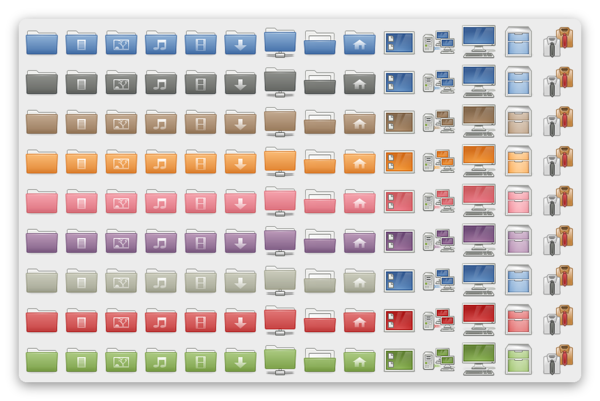

# gnome-colors

An unofficial update of the **GNOME-Colors** icon theme. The original artwork (last version was 5.5.2) is unmodified and for its sources check the src branch. The new additions are listed below.

**These additions were made using Claude, by Anthropic**, and tested on a real desktop. I will appreciate any feedback.

## Additions
- **48x48 PNG icons** for all variants (the original theme has 16 to 32 px plus scalable SVGs).
- **Names used by current Xfce**, such as the icons in the Settings manager, are mapped to fitting GNOME-Colors icons. Where GNOME-Colors has no matching art, icons are copied from [gnome-icon-theme](https://download.gnome.org/sources/gnome-icon-theme/3.12/) (3.12.0).
- **A few new or changed icons**, such as `folder-bookmarks`, `application-x-generic`, `x-office-addressbook`, `folder-projects`.
- **R file types** (for the mime types RStudio installs): a page with an R for scripts (`text-x-r-source`), a big R for projects (`application-x-r-project`), and plain gnome icons for the rest.

## Installing
The theme has the following variants: Brave (blue), Carbonite, Dust, Human, Illustrious, Noble, Tribute, Wine and Wise. All of them need `gnome-colors-common`, which holds the shared icons.

- **Per user:** copy `icons/gnome-colors-common` and the variant(s) you want into `~/.icons/`.
- **System-wide:** copy into `/usr/share/icons/`.
- Install [gnome-icon-theme](https://download.gnome.org/sources/gnome-icon-theme/3.12/) (3.12) as well; the theme inherits from it for icons it does not have.
- After copying, refresh the icon caches, e.g.

## Testing
- **System**: CRUX (3.8) with Xfce (4.20)
- **Not tested**: other desktops (MATE, Cinnamon, GNOME) and other GTK versions. Reports are welcome.

## Links
- Sibling project: [gtk-classic-themes](https://github.com/slackalaxy/gtk-classic-themes), classic GTK2 themes ported to GTK3/GTK4 and Xfwm4.
